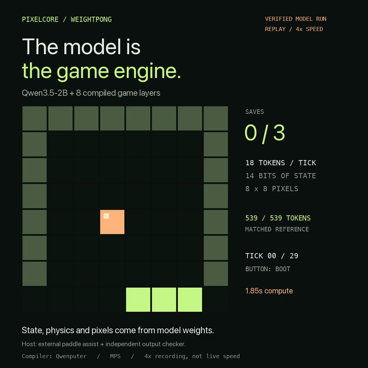
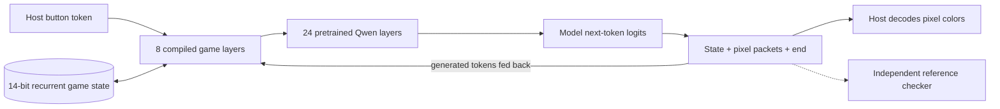
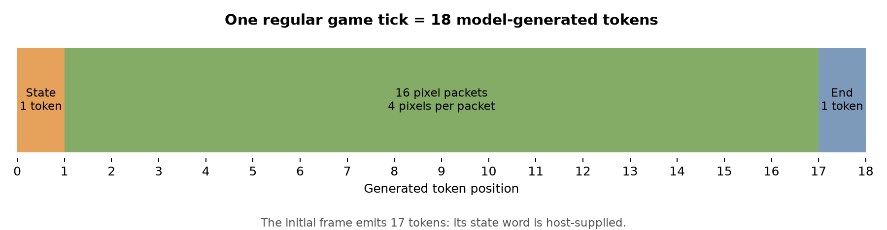
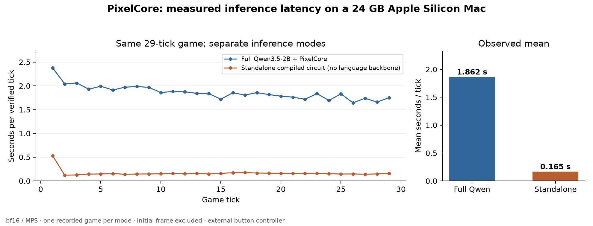
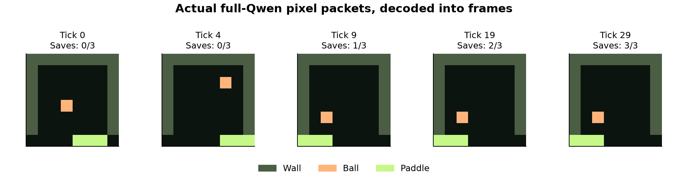
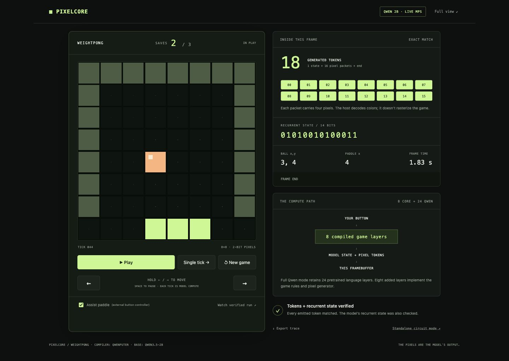

# PixelCore

**A tiny game engine, compiled into Qwen3.5-2B. The model generates the state and every pixel.**

PixelCore adds eight fixed transformer layers in front of Qwen's 24 pretrained
layers. They implement a complete 8×8 paddle game: ball motion, wall reflections,
paddle collisions, scoring, win/loss, reset, and a pixel generator. None of the
added weights are trained. The game is a circuit compiled into the model.

One button goes in. **Eighteen generated tokens** come out: the next state, all
64 pixels, and an end marker. The host decodes those pixels for display and runs
an independent checker; it does not supply replacement game results.



**[Full-quality video](docs/media/pixelcore-demo.mp4)** ·
[Design](docs/design.md) · [Research](docs/research.md) ·
[Results and raw data](docs/results.md) ·
[Standalone model download](https://github.com/Subh-Kami/pixelcore/releases/latest)

The clip is a **4× replay of an actual full-Qwen run on a 24 GB Apple Silicon
Mac**. The original compute time stays visible. An external controller supplies
paddle buttons; the model computes the game and its pixels.

## Why build this?

Language models usually talk about games or call an external game engine.
PixelCore explores a different boundary: make the engine itself a small,
inspectable computation inside the model's forward passes.

The project began with [qwenGPU](https://github.com/vixhal-baraiya/qwenGPU), a
SIMT GPU compiled into Qwen. The first experiment was a persistent particle
world and framebuffer running through CUDA kernels. It worked, but the visual
loop was slow. That led to a narrower question: **what if the layers represented
the game directly, instead of interpreting general GPU instructions?**

PixelCore is the resulting game-specific core. It trades general program support
for a compact state transition and a short pixel-output protocol. The earlier
CUDA experiment remains in this repository for comparison and reproduction;
its workload is different, so its timing is not used as a speedup benchmark.

## What runs inside the weights?



- **State:** ball x/y, horizontal and vertical directions, paddle position,
  score, and game-over flag live in a Gated DeltaNet head's recurrent state.
- **Rules:** Boolean and integer circuits implement motion, contact steering,
  reflections, scoring, terminal-state freezing, and reset.
- **Pixels:** sixteen generated packets each contain four two-bit pixels.
  The model computes which pixels are walls, ball, paddle, or background.
- **Verification:** every token and the recurrent state are checked. A mismatch
  stops execution. There is no silent reference fallback in model mode.

The full checkpoint runs all 32 layers through stock Transformers inference.
Qwen's pretrained layers are muted on game tokens using the upstream merge
technique. Their normal-text behavior is checked separately.



The first frame emits 17 tokens because its initial state is an input.
Subsequent state words are generated by the model, not re-uploaded by the host.
[The exact state layout and token format are documented here.](docs/design.md)

## Results

| Check | Observed result |
| --- | --- |
| Compiled game layers | 8, added to Qwen3.5-2B's 24 |
| Recurrent game state | 14 bits |
| Regular tick | 18 generated tokens |
| Reachable-state circuit check | 266 states, 1,064 action transitions matched |
| Persistent circuit sequence | 100 ticks matched without host state re-upload |
| Complete full-Qwen game | 29 ticks, three saves, **539/539 tokens matched** |
| Additional manual-input run | Movement, pause, reset and loss; **323/323 tokens matched** |
| Small text regression check | 40/40 top-token agreement; mean KL 5.49e-4 |
| Local targeted tests | 73 passed |

Two execution modes were measured on the **same game and button sequence**, in
bf16 on MPS. These are single-run prototype measurements:

| Mode | Pretrained language backbone? | Mean / tick | Median / tick |
| --- | --- | ---: | ---: |
| Full Qwen3.5-2B + PixelCore | Yes | 1.862 s | 1.842 s |
| Standalone compiled circuit | No | 0.165 s | 0.152 s |



The standalone model is a separate, roughly 54 MiB transformer containing the
game circuit and a zero helper layer. Its speed is **not** full-Qwen speed.
The combined Qwen checkpoint contains 5.81 GB of tensor data.
[Raw traces, logs, methodology and limitations](docs/results.md).



## Quickstart

Requirements: Python 3.11+, [uv](https://docs.astral.sh/uv/), and the pinned
project dependencies. Apple Silicon/MPS is the tested model-inference platform;
CPU and CUDA selection are supported but not benchmarked here.

```sh
git clone https://github.com/Subh-Kami/pixelcore.git
cd pixelcore
uv sync --locked
```

### Fast standalone circuit

This builds the emitted game weights locally without downloading Qwen:

```sh
uv run python -m qgpu.pixelcore.merge build/pixelcore-tiny
uv run pixelcore --checkpoint build/pixelcore-tiny --port 8767
```

Open **http://127.0.0.1:8767**. This is actual transformer inference, but it does
not contain the pretrained language backbone. A prebuilt compressed standalone
checkpoint is also available in [Releases](https://github.com/Subh-Kami/pixelcore/releases/latest).

After downloading `PixelCore-standalone-model.zip` from the release:

```sh
unzip PixelCore-standalone-model.zip -d build/
uv run pixelcore --checkpoint build/PixelCore-standalone --port 8767
```

### Full Qwen3.5-2B mode

```sh
uv run hf download Qwen/Qwen3.5-2B \
  --revision 15852e8c16360a2fea060d615a32b45270f8a8fc \
  --local-dir models/Qwen3.5-2B
uv run python -m qgpu.pixelcore.merge build/pixelcore-2b \
  --base models/Qwen3.5-2B
uv run pixelcore --checkpoint build/pixelcore-2b --port 8766
```

Open **http://127.0.0.1:8766**. Allow space for the 4.55 GB base download, the
5.81 GB merged checkpoint, dependencies and build overhead. The recorded runs
used a 24 GB Mac. Large checkpoints and caches are excluded from Git; the build
is reproducible from the pinned base revision and compiler dependency.

**Controls:** Play; hold left/right; Space pauses; three saves wins. New game
executes the compiled reset action. Assist paddle is an explicitly labeled
external button controller. Pausing finishes the tick already in progress.

A reference-only preview is available with `uv run pixelcore --port 8768`.
Its badge identifies it as a CPU interpreter, not model inference. The macOS
launchers `./run-pixelcore.command model` and `./run-pixelcore.command core`
are equivalent shortcuts.



## Reproduce the checks and figures

```sh
# Model-free circuit and runtime checks; also run in CI:
uv run pytest tests/test_pixelcore.py tests/test_world.py \
  tests/test_monitor.py tests/test_bridge.py -q

# Independently replay-check all published game traces:
uv run python scripts/verify_pixelcore_trace.py docs/results/full-qwen.json \
  docs/results/standalone.json docs/results/manual-input.json

# Record another complete game through the actual merged model:
uv run python scripts/validate_pixelcore.py build/pixelcore-2b --device mps \
  --output recordings/my-qwen-game.json

# Recreate the plots from the committed data:
uv run --with matplotlib==3.11.2 python scripts/plot_pixelcore_results.py

# Recreate the labeled video; requires ffmpeg:
uv run --with pillow==13.0.0 python scripts/render_pixelcore_clip.py \
  docs/results/full-qwen.json recordings/demo.mp4
```

The 73-test local suite additionally includes `tests/test_cuda.py`, which needs
an LLVM clang with the NVPTX backend. The model-free CI suite does not download
model weights or attempt GPU inference. See [results](docs/results.md) for the
text check, recordings and exact environment.

## Repository map

| Path | Purpose |
| --- | --- |
| [`qgpu/pixelcore/circuit.py`](qgpu/pixelcore/circuit.py) | Game rules, recurrent head, rasterizer and next-token circuit |
| [`qgpu/pixelcore/spec.py`](qgpu/pixelcore/spec.py) | Independent game specification and token format |
| [`qgpu/pixelcore/merge.py`](qgpu/pixelcore/merge.py) | Compile standalone or merged-Qwen checkpoints |
| [`qgpu/pixelcore/runtime.py`](qgpu/pixelcore/runtime.py) | Actual model decoding and lock checking |
| [`qgpu/pixelcore/server.py`](qgpu/pixelcore/server.py), [`ui/`](qgpu/pixelcore/ui/) | Local playable viewer |
| [`tests/test_pixelcore.py`](tests/test_pixelcore.py) | Reachable-state coverage, persistent sequences and mismatch guards |
| [`docs/results/`](docs/results/) | Recorded tokens, frames, measurements and logs |
| [`docs/research.md`](docs/research.md) | Papers, related work and contribution boundaries |
| [`WEIGHTWORLD.md`](WEIGHTWORLD.md) | Earlier resident-CUDA particle experiment |
| [`UPSTREAM_README.md`](UPSTREAM_README.md) | Original qwenGPU documentation |

## Related work and scope

This work builds directly on [Qwenputer](https://github.com/divagr18/qwenputer)
and [qwenGPU](https://github.com/vixhal-baraiya/qwenGPU). Compiled transformer
programs also have a longer research history, including
[Tracr](https://arxiv.org/html/2301.05062v5) and
[Tracr-Injection](https://arxiv.org/html/2505.10719v2). Existing in-model game work
includes the [Qwenputer Doom-floor-plan raycaster](https://github.com/mapestree/qwenputer-doom).

PixelCore's contribution is its **game-specific circuit, recurrent-state layout,
packed-pixel protocol and verified interactive implementation**. It is not a
general CUDA GPU, learned physics, or a claim to the first game inside an LLM.
The finite-state and numerical checks are not a formal proof of every possible
hardware implementation. [Detailed research discussion](docs/research.md).

## Credits and license

By [Subhanshu Dwivedi](https://github.com/Subh-Kami).

- **Qwenputer / Divyansh Agrawal:** compiler, exact transformer primitives and
  Gated DeltaNet memory conventions.
- **qwenGPU / Vixhal Baraiya:** original SIMT baseline and adapted merge/runtime
  techniques. The original Git history is retained.
- **Qwen team:** Qwen3.5-2B pretrained backbone.

Code is MIT; existing copyright notices are retained. Modified Qwen checkpoints
retain the base model's license. See [LICENSE](LICENSE),
[third-party notices](THIRD_PARTY.md), and [CITATION.cff](CITATION.cff).
