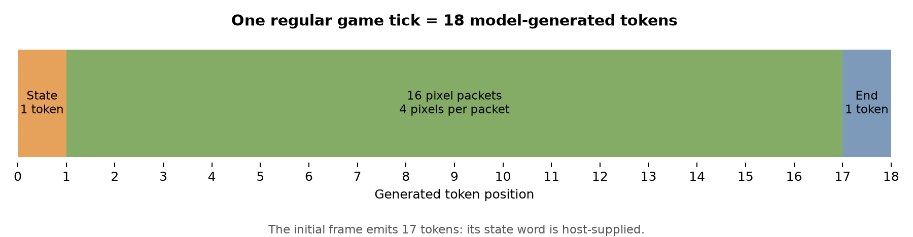

# Design: from a CUDA world to a game-specific core

## The experiment that came first

The first prototype retained qwenGPU's general SIMT machine. Three CUDA kernels
cleared a framebuffer, advanced particles and scattered their colors into an
8×8 image. The launch protocol uploaded world data once and kept it resident
across launches. Two complete frames ran through the merged model with exact
tokens and recurrent-memory checks.

That established correctness, but a frame used 489 generated execution tokens
and took roughly three minutes in the recorded setup. The pipeline was useful
for inspecting a GPU in weights, but slow as a visual interaction loop.

The next design gave up general CUDA program support. Instead, the game itself
became a compiled circuit. This is a specialization experiment, not a controlled
speed comparison: the particle workload and paddle game compute different things.

## One tick

The host supplies one of four button tokens: left, right, stay or reset.

1. A Gated DeltaNet head reads the current state.
2. Boolean/integer SwiGLU circuits compute the paddle move, wall reflections,
   paddle contact, horizontal steering, score and terminal flags.
3. The model predicts a packed state token.
4. Feeding that generated token back commits the new state to recurrent memory.
5. The model predicts sixteen pixel packets and an end token. Every pixel color
   is computed in the circuit from the committed state.

There is no host program that advances positions or supplies model-mode pixel
results. The reference specification does calculate an expected answer in
parallel, but only compares it with the model. A mismatch stops execution.

## State layout

The first game layer stores a single state row. Data columns 2–15 hold bits;
reference columns carry the compiler's ballast for exact reads.

| Bits | Field | Meaning |
| --- | --- | --- |
| 0–2 | x | Ball horizontal position |
| 3–5 | y | Ball vertical position |
| 6 | vx | 0 left, 1 right |
| 7 | vy | 0 up, 1 down |
| 8–10 | paddle | Paddle center |
| 11–12 | score | Saves, capped by the win state at 3 |
| 13 | over | Missed-ball terminal flag |

Initial state: ball `(3,4)`, right/up, paddle center `5`, score `0`, over `0`.
The paddle spans three cells; its center is restricted to 1–6. Ball positions
are restricted to the interior. At a paddle hit, contact left/right of center
steers the horizontal direction. Three saves wins. Both terminal states freeze
until reset.

The packed state is

```text
x | (y << 3) | (vx << 6) | (vy << 7) |
(paddle << 8) | (score << 11) | (over << 13)
```

The host supplies the initial state once. Subsequent state words are generated
by the model. The session keeps one model cache across ticks. A user-requested
reset is another compiled transition, not a host state replacement.

## Token format

Circuit IDs are offset after Qwen's original vocabulary in the merged model.
The standalone circuit uses the same circuit IDs directly.

| Circuit ID range | Record |
| --- | --- |
| 0–4095 | Pixel packet: `(chunk_index << 8) | payload` |
| 4096–16383 | Reserved |
| 16384–32767 | State: `16384 + packed_state` |
| 32768–32771 | Left, right, stay, reset |
| 32772 | Frame end |

There are sixteen chunks, each describing four consecutive row-major pixels.
The byte payload is `p0 | (p1 << 2) | (p2 << 4) | (p3 << 6)`.

| Pixel value | Color meaning |
| --- | --- |
| 0 | Background |
| 1 | Wall |
| 2 | Ball |
| 3 | Paddle |

The initial frame emits 16 pixel packets plus end. A regular action emits
state + 16 pixel packets + end: 18 tokens.



The next packet index follows the current token's chunk index; no host frame
cursor supplies the next pixel value. Tied embeddings and an output-code scheme,
adapted from the upstream projects, make the circuit's computed ID the greedy
next-token prediction.

## Compilation and merge

`PixelCore(Circ)` creates a graph of exact Boolean/integer SwiGLU operations and
one-hot-key Gated DeltaNet storage. Qwenputer's emitter turns that graph into
bf16 layer weights. The graph occupies eight linear-attention transformer layers.

The merged model widens the residual stream from 2048 to 2176 and prepends the
eight game layers to Qwen's 24. Game tokens get circuit features and an output
code; ordinary Qwen tokens get the text-mode features. The exit clears working
dimensions and the ballast, leaving the output code, token-mode flag and text
suppression signal. Qwen's original layers are muted on game tokens using the
upstream technique, while ordinary text behavior is checked separately.

The full model still executes all 32 layers for each generated token. PixelCore
does not report a circuit-only executor as full-Qwen inference.

## Standalone circuit

The same graph can be emitted into a compact model with residual width 128.
It has eight game layers and a zero full-attention helper layer that makes the
stock Transformers cache count positions. Its approximately 54 MiB checkpoint
contains no pretrained language backbone. It is useful for fast interactive
play and testing the circuit independently of the merge.

## Independent checks

The reference specification in `spec.py` uses ordinary game arithmetic. The
circuit implements the corresponding operations as transformer primitives.
Tests enumerate the specification's reachable states and compare every action's
state and pixels against the circuit evaluator. Separate model runs compare
actual logits-derived tokens and read the recurrent head directly.

The checker never substitutes its state for a model state. The UI distinguishes
full Qwen, standalone, reference and recorded replay. External paddle assistance
is a button policy, not learned model behavior.
