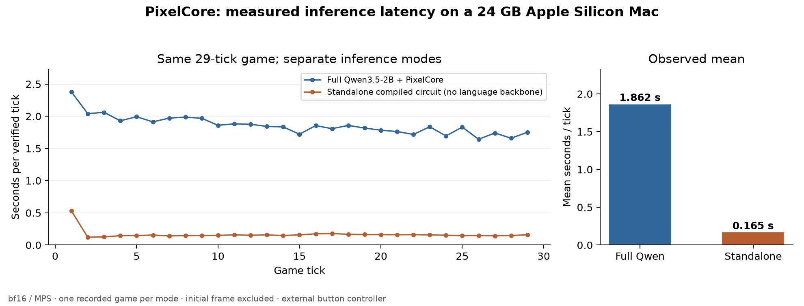
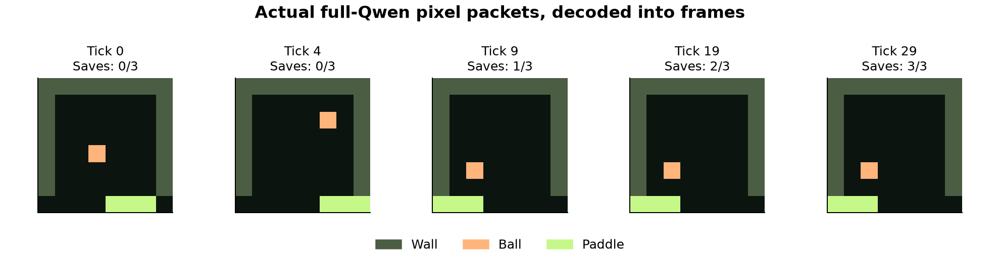

# Results and reproduction

All model timings below come from saved bf16/MPS runs on a 24 GB Apple Silicon
Mac. The full-Qwen and standalone recordings contain the same action sequence
and exactly the same generated game-token sequence. Each completes three saves
in 29 ticks. There is one recorded game per mode, so the plots show observations
rather than confidence intervals or broad performance claims.

## Actual model runs

| Mode | Generated tokens | Game result | Mean tick | Median tick | Min–max |
| --- | ---: | --- | ---: | ---: | ---: |
| Full Qwen3.5-2B + PixelCore | 539 / 539 matched | Three-save win | 1.862 s | 1.842 s | 1.643–2.376 s |
| Standalone game transformer | 539 / 539 matched | Three-save win | 0.165 s | 0.152 s | 0.121–0.528 s |

The 539 tokens comprise the initial 17-token frame and 29 regular 18-token ticks.
Timing statistics exclude the initial frame. The host's independent check is
part of the runtime; timings are not GPU-kernel-only microbenchmarks.



| Evidence | Data | Log |
| --- | --- | --- |
| Full-Qwen game | [full-qwen.json](results/full-qwen.json) | [full-qwen.log](results/full-qwen.log) |
| Standalone game | [standalone.json](results/standalone.json) | [standalone.log](results/standalone.log) |
| Manual input/reset/loss | [manual-input.json](results/manual-input.json) | Exported from the live viewer |
| Text regression | [text-check.json](results/text-check.json) | [text-check.log](results/text-check.log) |
| Targeted local suite | 73 tests passed | [tests.log](results/tests.log) |

The manual-input recording contains 323 exact tokens across 18 frames, including
held movement, a compiled reset and a deliberately missed ball. Its final state
is game-over. Browser checks also exercised pause, export and the standalone
win path; no console errors were observed in those checks.

The full merged model executes all 32 layers. The standalone checkpoint contains
no pretrained language backbone, so the faster standalone timing is not evidence
that full Qwen runs at that rate.

## Pixel output

These images are decoded directly from the full-Qwen recording. There is no host
interpolation or physics step between them.



The [demo GIF](media/pixelcore-demo.gif) and [MP4](media/pixelcore-demo.mp4) are
explicitly labeled 4× replay. They retain each frame's original compute time and
identify the external paddle-assist input policy. A replay is not live inference.

## Circuit coverage

A breadth-first traversal of the independent game specification finds 266
reachable states. Each has four actions, yielding 1,064 transitions. The exact
circuit evaluator checks every transition's state and pixels, plus a persistent
100-tick sequence with no host state re-upload after initialization.

The evaluator checks the circuit primitives' numerical invariants. Separate
runtime guards deliberately inject wrong tokens or recurrent-state reads and
verify that decoding stops instead of substituting the reference answer.
This is finite-state/numerical testing, not a formal proof of all possible
library and hardware implementations.

## Ordinary-text regression check

A bf16 CPU comparison used four short prompts and 40 token positions:

- 40/40 top-token agreement with base Qwen3.5-2B;
- mean KL divergence: `0.0005491508054547012`;
- maximum KL divergence: `0.0023637753911316395`;
- no game-token leakage into ordinary text.

This is a small regression check, not a language-quality benchmark or evidence
about long conversations, all prompts, or every device.

## Reproduce

```sh
uv sync --locked
uv run pytest tests/test_pixelcore.py tests/test_world.py \
  tests/test_monitor.py tests/test_bridge.py -q
uv run python scripts/verify_pixelcore_trace.py docs/results/full-qwen.json \
  docs/results/standalone.json docs/results/manual-input.json
```

Those commands require no model weights or GPU. The full local 73-test suite
additionally runs `tests/test_cuda.py` with LLVM's NVPTX backend.

After building a checkpoint as described in the main README:

```sh
uv run python scripts/validate_pixelcore.py build/pixelcore-2b --device mps \
  --output recordings/full-qwen.json
uv run python scripts/validate_pixelcore.py build/pixelcore-tiny --device mps \
  --output recordings/standalone.json
uv run python scripts/check_pixelcore_text.py models/Qwen3.5-2B \
  build/pixelcore-2b --output recordings/text-check.json
```

Recreate the figures from the committed recordings:

```sh
uv run --with matplotlib==3.11.2 python scripts/plot_pixelcore_results.py
```

The plotting script verifies both traces and asserts that their generated token
streams match before producing figures. [plot-data.json](media/plot-data.json)
contains the computed summary. No benchmark values are invented for the plots.

Recreate the video with Pillow and ffmpeg:

```sh
uv run --with pillow==13.0.0 python scripts/render_pixelcore_clip.py \
  docs/results/full-qwen.json recordings/demo.mp4
```

## Pinned inputs and environment

| Component | Recorded value |
| --- | --- |
| Base model | `Qwen/Qwen3.5-2B` |
| Base revision | `15852e8c16360a2fea060d615a32b45270f8a8fc` |
| qwenGPU starting commit | `e2695f6a0a818ebc68e2e14b6b990eddf04c51b3` |
| Qwenputer/compiler revision | `f07a0b2e38271454c4d455dc2b9bf78d3d399170` |
| Python | 3.15 |
| PyTorch | 2.15.0 |
| Transformers | 5.22.1 |
| Inference | bf16, MPS |
| Local CUDA prototype compiler | LLVM 23.1.4 |
| Plot renderer | Matplotlib 3.11.2 |
| Video renderer | Pillow 13.0.0 and ffmpeg |

Full-Qwen tensor data totals 5,805,412,992 bytes. The compact standalone model is
about 54 MiB before compression. The dependency lockfile is committed; large
base/merged checkpoints, virtual environments and caches are not.

## Limits of the evidence

A backend label in a JSON file is not cryptographic attestation. These particular
recordings were produced by actual local model runs and are accompanied by run
logs, but the replay verifier establishes consistency with the specification,
not hardware provenance by itself.

The earlier resident CUDA particle experiment computes a different workload.
Its 489 generated tokens/frame and approximately three-minute frames are not a
controlled speedup benchmark for WeightPong. PixelCore's reduction in scope is
part of the design, not evidence that it replaces a general GPU.
